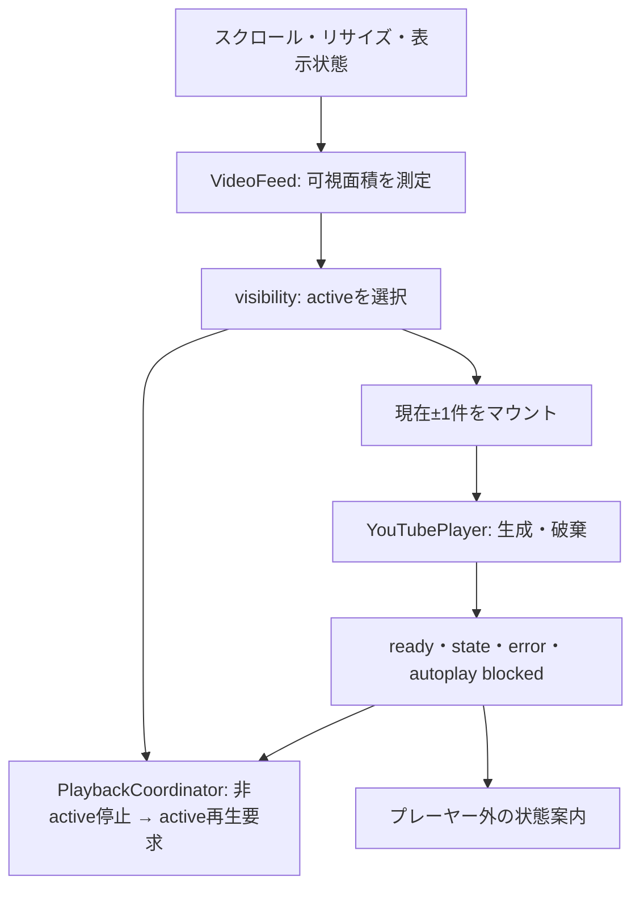

# Phase 1 コードガイド・共有手順

このドキュメントは、Phase 1のコードを初めて読む共同開発者向けの案内です。仕様は[SPEC.md](SPEC.md)、実装範囲と検証結果は[README](../README.md)を参照してください。

## 共有する実装

作業ブランチは`feature/phase-1-player-spike`、レビュー先は[Draft PR #7](https://github.com/Luke0703/knowledge-stream/pull/7)です。mainへのマージはまだ行っていません。

Reactの画面、Cloudflare Worker、設定、依存関係のロックファイル、テスト、仕様書をGitで管理します。`node_modules/`と`dist/`は下記のコマンドで復元できる生成物のため含めません。`.env*`、`.dev.vars*`、`.wrangler/`、ログなどの端末固有データも追跡対象外です。

## 別のPCで復元・起動する

リポジトリへのアクセス権があるGitHubアカウントと、Git、Node.js 22.12以上、pnpm 11.25.0を用意します。

```sh
git clone --branch feature/phase-1-player-spike https://github.com/Luke0703/knowledge-stream.git
cd knowledge-stream
pnpm install --frozen-lockfile
pnpm typecheck
pnpm test
pnpm build
pnpm dev
```

ブラウザで`http://localhost:5173`を開きます。Cloudflareへのログインや秘密情報は不要です。ビルド済み成果物は`pnpm preview`で確認できます。既存の作業コピーを更新する場合は、ローカル変更を確認してから対象ブランチ上で`git pull --ff-only`を実行してください。

同じWi-FiのiPhoneへ共有する場合は、ビルド後に`pnpm preview:lan`を実行します。[iPhone Safari検証手順](IPHONE_SAFARI_QA.md)に接続先の調べ方と確認結果を記録しています。`vite.config.ts`の`lan`モードでデバッグ・管理機能を無効化し、ビルド済みアプリをポート4174で提供します。

## ファイルごとの役割

| ファイル | 役割 |
| --- | --- |
| `index.html` | 日本語ページ、viewportとReferer方針、Reactの起動点 |
| `src/main.tsx` | Reactをマウント。StrictModeでライフサイクルの問題も検出 |
| `src/App.tsx` | ヘッダー、Worker疎通表示、動画フィード、3タブの外枠 |
| `src/videos.ts` | テスト動画3本の内部UUID・YouTube ID・独自説明ラベル |
| `src/VideoFeed.tsx` | 可視領域の測定、activeの更新、現在±1件のマウント、前後操作 |
| `src/player/visibility.ts` | 可視面積率、active選択、マウント範囲を決める純粋関数 |
| `src/player/PlaybackCoordinator.ts` | 再生対象を一元管理し、他のプレーヤーを停止 |
| `src/player/youtubeApi.ts` | 公式IFrame APIの共有ロード、15秒タイムアウト、失敗後の再試行 |
| `src/player/YouTubePlayer.tsx` | YT.Player生成・イベント処理・エラー表示・破棄 |
| `src/styles.css` | scroll-snap、プレーヤー外の操作領域、safe-area、小画面対応 |
| `shared/api.ts` | ブラウザとWorkerで共有するhealthレスポンスの型 |
| `worker/index.ts` | `GET /api/v1/health`と未実装パスのJSON 404 |
| `vite.config.ts` | ReactとCloudflare公式Viteプラグインの接続 |
| `wrangler.jsonc` | 単一Worker、Static Assets、SPA fallback、API優先ルーティング |
| `tsconfig.*.json` | ブラウザ・Node設定ファイル・Workerの型チェック環境を分離 |
| `vitest.config.ts` / `tests/` | テスト設定、再生制御・プレーヤー・APIの回帰テスト |
| `package.json` / `pnpm-lock.yaml` | 起動・検証コマンド、依存関係の再現 |
| `pnpm-workspace.yaml` | esbuild/workerdのインストールスクリプトを許可 |

## 起動から動画切り替えまで

1. `App`が`/api/v1/health`を呼び、Workerの接続状態を表示します。動画一覧はローカルの固定データを使うため、このAPIの失敗でフィードは停止しません。
2. `VideoFeed`がカードを配置し、先頭と次の動画のプレーヤーをマウントします。APIスクリプトの読み込みPromiseを共有し、複数コンポーネントからの重複ロードを抑えます。
3. スクロール・リサイズ・タブ表示状態の変更などでカードとプレーヤーの可視面積を測定します。カード65%以上、プレーヤー50%以上が表示されているものをactiveにします。該当しなければactiveは`null`です。
4. `PlaybackCoordinator`が非active動画を停止してから、active動画をミュートして再生要求します。自動再生の成功自体はブラウザとYouTubeに依存します。
5. activeが確定したら、その前後1件だけを残します。範囲外のコンポーネントをアンマウントし、プレーヤーを破棄します。



`active`は現在の再生対象、`center`は最後にactiveになった動画です。切り替え途中でactiveが`null`になってもcenterを保持し、必要なiframeを毎回生成し直さないようにしています。前後ボタンも直接再生するのではなく、いったん停止して対象カードへ移動し、可視面積の再測定に再生許可を任せます。

## 再生制御で注意する点

- readyイベントは動画移動後に届くことがあります。`register()`時点で現在のactiveを確認するため、遅れて準備ができた非active動画は再生しません。
- `onStateChange`でも非activeの再生/バッファリングを検知して停止します。Reactの描画完了だけに再生判断を依存させません。
- 同じactiveの測定が続いても再生要求を繰り返しません。表示が変わらない間、標準UIでの手動停止を維持します。別動画から戻ったときやタブ復帰時はミュート自動再生を再度試みます。
- `useLayoutEffect`のcleanupで、ReactがDOMを外す前に停止・破棄します。通常の`useEffect`のcleanupだとYouTube APIが外れたiframeを操作する警告につながります。
- React管理のホスト要素の中に専用の子要素を作り、YouTubeにはその子だけを置き換えさせます。cleanup後の非同期イベントは`cancelled`で無視します。
- 自動再生拒否と動画の削除・埋め込み禁止は別扱いです。拒否時はYouTube標準の再生操作を案内し、エラー時は独立した領域に再試行を表示します。
- iframe内部のスワイプが外側へ届くとは仮定しません。タッチを横取りする透明レイヤーは設けず、前後操作をプレーヤー外に置きます。

## 変更箇所の探し方

| 変更したい内容 | 最初に確認する箇所 |
| --- | --- |
| 動画の差し替え | `src/videos.ts`とREADMEの確認手順 |
| activeになる表示率 | `visibility.ts`と`tests/playback.test.ts` |
| ロードする前後件数 | `inMountWindow()`と再生・メモリ使用の検証 |
| エラー文言や再試行 | `YouTubePlayer.tsx`と`tests/player.test.tsx` |
| 余白・サイズ・ナビの配置 | `styles.css`。標準UI非干渉と最低200×200pxを再確認 |
| Worker疎通 | `worker/index.ts`、`shared/api.ts`、`tests/worker.test.ts` |

Phase 1は最大5件程度の固定データを想定し、カード全件を測定します。大規模フィード向けの最適化、視聴履歴、検索、管理、評価、D1はこの実装に含まれません。

## テストと引き継ぎ

現在の13テストは、表示率・ロード範囲、再生停止順序、遅延イベント、タブ非表示、StrictMode、DOM接続中の破棄、エラー/再試行、Workerレスポンスを確認します。実際のYouTube通信をモックするテストもあるため、端末固有の再生やタッチ挙動は保証しません。

共有後は[READMEの実機チェックリスト](../README.md#未完了の手動実機チェック)を使ってiPhone Safariを確認してください。実施日・端末・OS・結果を残し、未検証のまま完了扱いにしないことが引き継ぎ事項です。
